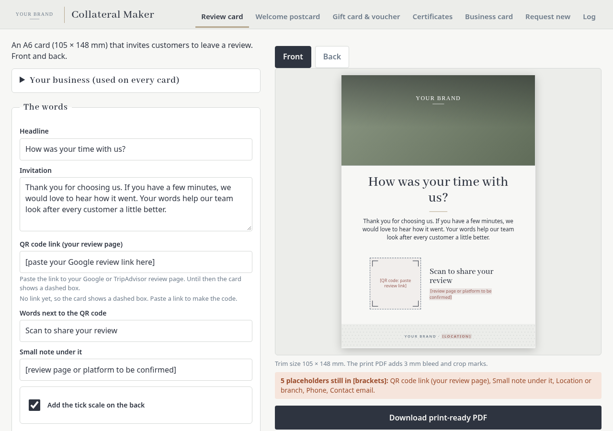

# Collateral Maker

A small, self-contained tool for producing print-ready marketing collateral. Fill in the words, pick a
picture, and download a PDF or PNG. It is one HTML file: no server, no account, no build step needed to use it.



## What it makes

- **Review card** (A6, front and back) with a QR code to your review page
- **Welcome postcard** (front and back)
- **Gift card and gift voucher**, with suggested running numbers (`GV-0001`, `GC-0001` ...)
- **Certificates** (excellence and award)
- **Business cards**: a digital one (phone screen, with a downloadable contact file) and a printed one

Features:

- Every piece has editable fields. Details shared between pieces (business name, place, phone, email) are
  typed once and fill every card.
- Date pickers for "valid until" and issue dates, with one-click "today" and "12 months from today".
- QR code generator: paste a link (or just `yourbrand.com`) and a scannable code is drawn on the piece.
- Export as **print-ready PDF** (3 mm bleed and crop marks), **screen PDF**, or **PNG**.
- **Log** of everything you have made, with **CSV export**.
- **Request tab**: describe a piece that is not here, and it opens an email addressed to the address you set in `CONFIG`.
- Your own photo can be used as the picture background (kept on the device, shrunk to fit).
- Works on phones: the layout adapts down to about 360 px wide.

## Run it

Open `index.html` in a modern browser (Chrome, Edge, Safari, Firefox). That is all. It works from a local
file and offline.

## Rebrand it (the CONFIG block)

All brand settings live in one commented block: `window.CONFIG`, at the very top of `index.html`
(and in `src/config.js`, which is where the block comes from). It sets:

| Setting | What it does |
|---|---|
| `brandName`, `tagline`, `location`, `website`, `appTitle` | Names and text used on every piece and the page |
| `requestEmail` | Where the Request tab's "Email this request" button sends to |
| `numberPrefixes` | Prefix for voucher and gift card numbers |
| `colors` | Six colours: ink, accent, paper, band, highlight, line |
| `fonts` | CSS font stacks for headings and body |
| `logo` | Your own SVG artwork (inline SVG or data URI); by default a text logo is drawn from `brandName` |
| `images` | The picture backgrounds in the dropdown: a gradient or a data URI/URL |
| `pattern` | Footer strip pattern: `"dots"`, `"lines"` or `"none"` |
| `storagePrefix` | Browser storage name (change it if two copies share one website address) |

Two ways to apply a change:

1. **No tools needed:** edit the CONFIG block at the top of `index.html` in any text editor, save, reload the page.
2. **Rebuild:** edit `src/config.js`, then run `node build.js` (Node 14+, no packages) to regenerate `index.html`.

Notes:

- Bundled fonts are Abhaya Libre and Noto Sans. A different font only shows if it is installed on the
  viewing device, unless you embed it yourself (see the `fontCSS` handling in `build.js`). Keep a fallback in the stack.
- Logos must be inline SVG or a data URI, not a file path, so that exports carry them.
- To change the words or layout of a piece, edit `src/pieces.js` (the designs are plain HTML and CSS in millimetres)
  and `src/maker.js` (the app), then rebuild.

## Host it

It is a static page, so any static host works: GitHub Pages, Netlify, Cloudflare Pages, an S3 bucket, or a
folder on a web server. Upload `index.html` (the other files are only needed to rebuild). For GitHub Pages,
push the repo and enable Pages from the main branch root.

## Limitations

- **Everything is stored in each browser** (`localStorage`): saved field values, the log and an uploaded photo.
  Nothing is sent to a server, so a different browser, device or cleared site data starts fresh, and the log is
  not shared between people. Use CSV export to keep a record.
- The request tab uses a `mailto:` link, so it needs an email app on the device; there is also a copy button.
- PDF export draws each page to an image, so the PDF is not selectable text. Print-ready PDFs are rendered at high resolution.
- Colours are shown as RGB; printers may convert to CMYK and shift tones slightly. Always proof first.
- Number suggestions come from this browser's log, so two people can suggest the same number.
- The layouts are sized for the formats listed above (A6, ID-size cards and so on).

## Repository layout

```
index.html        the app (built file; contains the CONFIG block at the top)
build.js          builds index.html from src/
src/config.js     brand settings
src/pieces.js     the collateral designs
src/maker.js      the app
src/maker.css     app styling
src/pdf.js        minimal PDF writer
src/vendor/       qrcode-generator (MIT)
src/fonts/        Abhaya Libre, Noto Sans (SIL OFL)
LICENSES/         third-party licence texts
docs/screenshots/ screenshots
```

## Licence

MIT, see `LICENSE`. Third-party notices are in `NOTICE.md` and `LICENSES/`.
